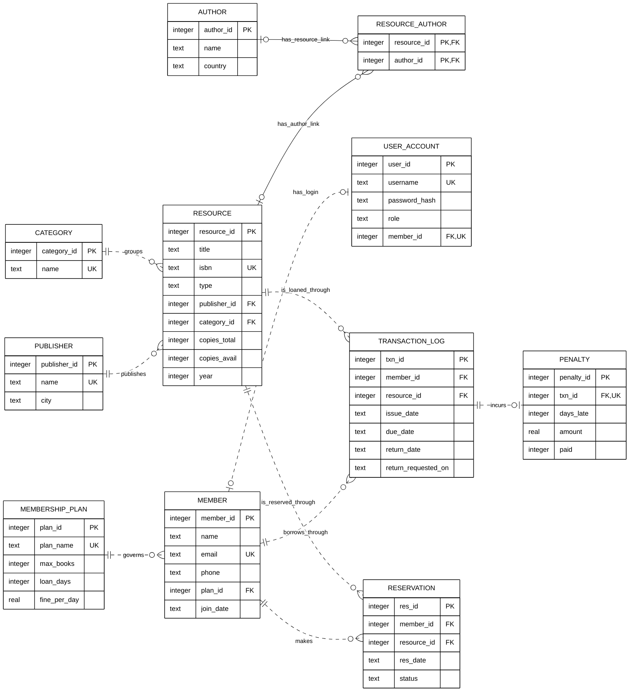

# Intelligent Library & Digital Resource Management System

A Python and SQLite DBMS capstone for cataloging physical and digital resources, managing library memberships, and tracking loans, reservations, and overdue fines. It includes a browser-based portal for administrators and members, plus a standalone command-line demo for exploring SQL queries and circulation operations.

## Contents

- [Getting started](#getting-started)
- [Library workflows](#library-workflows)
- [Database design](#database-design)
- [Reports and SQL](#reports-and-sql)
- [Project files](#project-files)
- [Troubleshooting](#troubleshooting)

## Getting started

Run the commands from the project directory containing `app.py`, `main.py`, and the SQL files. The application uses Python 3 and standard-library modules, including `sqlite3`. No Python packages need to be installed. The web app requires a browser, and the standalone SQL examples below use the optional `sqlite3` command-line tool.

### Web application

```sh
python3 app.py
```

Open [http://localhost:8000](http://localhost:8000). Press **Ctrl+C** in the terminal to stop the server.

The web app opens `library_web.db` from the same directory as `app.py` and keeps changes across restarts. If the database is absent, startup creates it from `schema.sql` and `data.sql`, then creates the demo accounts. Startup also adds the return-request column to older database copies that lack it.

| Role | Username | Demo password |
| --- | --- | --- |
| Administrator | `admin` | `admin123` |
| Member | `aman` | `aman123` |
| Member | `riya` | `riya123` |
| Member | `mehta` | `mehta123` |
| Member | `kabir` | `kabir123` |

The server binds to localhost and is intended for a local demo with sample data. It stores passwords as salted PBKDF2-HMAC-SHA256 hashes and holds sessions in memory. Restarting the server signs users out.

### Command-line demo

```sh
python3 main.py
```

**Each CLI launch replaces `library.db` in the current directory.** Back up that file first if you need its contents. The CLI uses its own database, separate from the web app.

Startup seeds the database, prints the analytics reports, and runs a sample issue and return. Enter `y` at the interactive-menu prompt to issue, return, or reserve a resource, view reports, or exit. Circulation actions use numeric member, resource, and transaction IDs.

## Library workflows

| Administrator | Member |
| --- | --- |
| Add resources and link their authors, publisher, and category. | Register with an email address or sign in with an existing account. |
| Create a member under a chosen plan and optionally create a login. | Browse the catalog, borrow an available resource, or place a reservation. |
| Issue resources, confirm or reject return requests, and mark fines as paid. | View personal loans, reservations, fines, and membership details. |
| Review circulation reports and inspect SQLite objects through the read-only console. | Submit a return request for an open loan. |

### Borrowing and due dates

The web app checks available copies, the member’s plan limit, and whether the member already has the resource on loan. A successful issue records the loan, calculates the due date from the plan’s loan period, and decrements available copies. Web self-registration assigns the Student plan from the seed data.

| Seed plan | Maximum open loans | Loan period | Fine per overdue day |
| --- | ---: | ---: | ---: |
| Student | 3 | 14 days | ₹2.00 |
| Faculty | 6 | 30 days | ₹1.00 |
| Premium | 10 | 45 days | ₹0.50 |

### Returns and fines

A member’s return request records the request date while the loan remains open. An administrator confirms receipt to close the loan and restore a copy to inventory. For a late return, the system multiplies the number of overdue days by the member’s plan rate and creates a penalty. Rejecting a request clears the request date and leaves the loan open. Marking a fine as paid updates its payment status in SQLite.

### Reservations and demo dates

The web app rejects duplicate active reservations for the same member and resource. New reservations are stored as `ACTIVE`. The schema also accepts `FULFILLED` and `CANCELLED`, while the supplied workflows create active reservations only.

Both programs and the overdue view use **2026-11-18** as the reference date so the sample results are reproducible. Loan dates, return dates, and overdue calculations therefore follow the demo date.

## Database design

The schema defines 11 application tables and 11 foreign keys. Each resource belongs to one publisher and one category. The `resource_author` junction table records authorship, and each membership plan defines the loan rules for its members. The circulation tables record borrowing and reservations independently.

### ER model



- **Authorship.** The junction table has a composite primary key on `(resource_id, author_id)`. The app writes both IDs when creating a link. SQLite permits nulls in these columns as declared, so the diagram shows optional parent ends.
- **Accounts.** A unique, nullable member foreign key allows at most one account per member. The seeded administrator has no member record.
- **Penalties.** A unique transaction foreign key allows zero or one penalty per loan. Dates are stored as ISO-formatted text, and the paid status is stored as an integer.
- **Constraints.** Both Python entry points enable foreign-key enforcement. Schema checks restrict the resource type and reservation status and require nonnegative copy counts. A resource’s ISBN is optional and unique when supplied.

## Reports and SQL

| View | Purpose |
| --- | --- |
| `v_overdue` | Lists open loans past their due date with days overdue and the estimated fine as of the demo date. |
| `v_popular_resources` | Tallies borrowing transactions by resource. |
| `v_member_summary` | Shows plan names, lifetime borrowing counts, and an open-loan count for each member. The current view can report one open loan for a member with no transactions because its aggregate counts the null row produced by the left join. |

`queries.sql` also demonstrates monthly borrowing and unpaid balances using common table expressions, plus borrowing by category and late-return history. Use the optional SQLite CLI to run all sample reports against the web database in read-only mode.

```sh
sqlite3 -readonly -header -column library_web.db < queries.sql
```

The admin SQL console accepts one `SELECT`, `WITH`, `PRAGMA`, or `EXPLAIN` statement at a time on a read-only database connection and returns up to 500 rows. The schema defines indexes on the transaction’s member ID, resource ID, and due-date/return-date pair, and on the resource title. Try this query in the admin console to inspect SQLite’s index selection.

```sql
EXPLAIN QUERY PLAN
SELECT *
FROM transaction_log
WHERE member_id = 1;
```

## Project files

| File | Purpose |
| --- | --- |
| `app.py` | Local HTTP server, role-based login, JSON endpoints, circulation commands, and database initialization. |
| `main.py` | Standalone CLI demo, interactive menu, and analytics. |
| `login.html` | Sign-in and self-registration page. |
| `admin.html` | Administrator dashboard, reports, and database console. |
| `user.html` | Member catalog, loans, reservations, fines, and profile. |
| `schema.sql` | SQLite tables, constraints, indexes, and views. |
| `data.sql` | Seed catalog, members, membership plans, loans, reservations, and penalties. |
| `queries.sql` | SQL reporting examples. |
| `library_web.db` | Supplied SQLite database used by the web app. |
| `Library_Management_Presentation.pptx` | Capstone overview, database design, and analytics presentation. |

## Troubleshooting

| Symptom | Check |
| --- | --- |
| The browser cannot open the app | Keep `python3 app.py` running and use `http://localhost:8000`. If the terminal reports that the address is already in use, stop the other local server or change `PORT` in `app.py` and open the matching URL. |
| The CLI cannot find the SQL scripts | Run `python3 main.py` from the project directory. The CLI resolves `schema.sql` and `data.sql` relative to the current directory. |
| Demo credentials differ from the table | The web app reuses the existing database. To start fresh, stop the server and move `library_web.db` to a backup location before restarting. The app will seed a new database. |
| Web and CLI results differ | The web app persists changes in `library_web.db`. The CLI rebuilds `library.db` and performs a sample issue and return at startup. |
| The ER model displays as source text | Open the README in a Markdown viewer with Mermaid support. |
